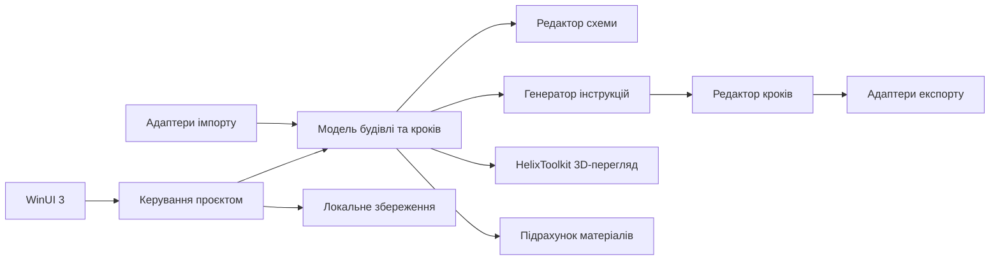

# ShemBuild — дизайн-документ

> **Статус:** зафіксована фінальна версія дизайну  
> **Версія:** 2.1  
> **Дата:** 23 листопада 2026 року

## 1. Коротко про проєкт

**ShemBuild** — Windows-застосунок для роботи з Minecraft-схемами. Користувач може відкрити схему, переглядати її у 3D, редагувати будівлю та автоматично створювати покрокову інструкцію у стилі LEGO. Згенеровану інструкцію можна змінювати й експортувати.

### Підтверджені рішення

- Цільова платформа — Windows; візуальний стиль і поведінка інтерфейсу мають відповідати звичним патернам Windows 11.
- Користувач відкриває наявну схему, переглядає та редагує її.
- Застосунок автоматично генерує покрокову інструкцію; користувач може редагувати й експортувати її.
- Ціль сумісності — охопити доступні формати схем і версії Minecraft.
- Підтримувати потрібно обидва видання Minecraft: Java Edition і Bedrock Edition.
- Початкова матриця MVP обмежена Java Edition; Bedrock Edition додається наступним етапом.
- MVP орієнтується на найновішу стабільну Java-версію на момент розробки; snapshots і prereleases не входять до початкової матриці.
- Застосунок може конвертувати схеми між виданнями та версіями Minecraft; для блоків без точного відповідника пропонує схожі варіанти.
- Схожі блоки добираються за зовнішнім виглядом і функцією; користувач підтверджує кожну приблизну заміну.
- Перший формат імпорту для MVP — `.schem`.
- У MVP видання зафіксоване як Java Edition; версію потрібно прочитати з файлу й підтвердити під час відкриття або запропонувати вибір вручну.
- Редагування схеми включає додавання, видалення та заміну блоків, переміщення частин і поворот моделі на 90 градусів; масштабування стосується лише 3D-перегляду.
- Пріоритет інструкції — простота повторення, а не мінімальна кількість кроків; користувач може задати частини вручну або обрати автоматичний поділ, який сам добирає зрозумілу послідовність.
- Кожен крок інструкції має бути реально виконуваним у Minecraft у вказаному порядку, з урахуванням вимог розміщення блоків.
- Логічні групи будівлі мають назви й підтримують вкладеність (наприклад: будівля → стіни → вікна).
- Якщо схему змінено після створення інструкції, застосунок пропонує користувачу вибрати подальшу дію.
- Під час повторної генерації ручні правки інструкції зберігаються там, де їх можна узгодити з оновленою схемою.
- Інструкцію можна зберегти у власному форматі ShemBuild та експортувати у PDF.
- Власний формат інструкцій ShemBuild має розширення `.svb`.
- Файл `.svb` самодостатній: містить вихідну схему, усі правки й інструкцію та відкривається на іншому комп’ютері без окремого вихідного файлу.
- Інтерфейс та інструкції мають бути українською й англійською; початкова мова визначається мовою Windows.
- Застосунок підтримує світлу й темну тему Windows.

Підтримка форматів і версій розширюється поетапно та фіксується у перевіреній матриці сумісності. Для експорту користувач обирає серед форматів, підтримуваних для цільового видання й версії.

## 2. Проблема та цінність

Minecraft-схему можна оглядати у 3D, але з неї не завжди зрозуміло, у якій послідовності збирати споруду та які блоки потрібні на кожному кроці. ShemBuild поєднує редагування самої будівлі з автоматичним створенням зрозумілої інструкції.

**Цінність для користувача:** перетворити наявну схему на зручний план збирання, скоригувати будівлю чи порядок кроків і поділитися результатом через експорт.

## 3. Цілі та межі

### Повне бачення продукту

1. Переглядати, редагувати, обертати й переміщувати Minecraft-схеми.
2. Конвертувати схеми між виданнями та версіями, пропонуючи заміни для блоків без точного відповідника.
3. Генерувати фізично виконувану покрокову інструкцію з простими для повторення кроками.
4. Дозволяти ручне групування будівлі та редагування інструкції.
5. Зберігати проєкт у самодостатньому форматі `.svb` та експортувати схеми й інструкції.
6. Поетапно додавати підтримку форматів і версій Minecraft через адаптери.

### MVP: простий переглядач схем

MVP зосереджений на перегляді, без редагування будівлі, конвертації або генерації інструкцій.

MVP націлений на Java Edition `.schem` для найновішої стабільної версії на момент початку розробки; snapshots і prereleases не входять до початкової матриці. Станом на 23 листопада 2026 року офіційна сторінка Mojang вказує [Java Edition 26.3](https://www.minecraft.net/en-us/article/minecraft-java-edition-26-3) як останній повний реліз; ціль записана в [матриці сумісності](COMPATIBILITY.md), але її ще не перевірено на схемі цієї версії.

1. Відкрити Java Edition файл `.schem` та побачити зрозуміле повідомлення, якщо він не підтримується.
2. Визначити Java-версію з метаданих і попросити підтвердження; якщо версії немає, дати змогу вибрати її вручну.
3. Показати схему в інтерактивному 3D-вікні з обертанням ракурсу, масштабуванням камери та переміщенням огляду.
4. Показати габарити схеми й базове зведення блоків.
5. Перегляд не змінює вихідний файл схеми.

### Етапи після MVP

- Додати імпорт і перегляд схем Bedrock Edition.
- Редагування блоків і частин будівлі.
- Генерація та ручне редагування інструкцій, тимчасові опори, `.svb` і PDF.
- Конвертація між виданнями та версіями; розширення переліку форматів імпорту/експорту.

### Поза межами проєкту

- Автоматичне розміщення блоків у світі Minecraft.
- Керування сервером, інвентарем або персонажем.
- Спільне редагування схеми кількома гравцями.
- Каталог схем із користувацькими профілями та рейтингами.
- Редагування текстур або створення довільних 3D-моделей.

## 4. Користувачі та основні сценарії

### Основний користувач

Гравець Minecraft, який має схему споруди та хоче переглянути, скоригувати її, отримати послідовну інструкцію збирання й експортувати її для використання поза застосунком.

### Сценарій: створити та відредагувати інструкцію

1. Користувач відкриває схему підтримуваного формату.
2. Перевіряє модель у 3D та за потреби повертає будівлю, редагує блоки або переміщує частини.
3. Обирає, чи вручну розбити будівлю на частини, чи доручити це системі.
4. Запускає генерацію; система добирає зрозумілу послідовність із пріоритетом простих для повторення кроків.
5. Переглядає кроки разом із 3D-підсвічуванням змін на кожному кроці.
6. Додає, видаляє, об’єднує, розділяє або переставляє кроки.
7. Перевіряє матеріали та зберігає інструкцію у форматі ShemBuild або експортує її у PDF.
8. За потреби зберігає проєкт, щоб пізніше продовжити редагування.

### Сценарій: оцінити потребу в матеріалах

1. Користувач відкриває схему або інструкцію.
2. Переглядає зведення блоків за типами.
3. Перемикає зведення між усією спорудою, вибраним кроком та ще не зібраними кроками.

## 5. Функціональні вимоги

### Імпорт і проєкти

- Відкриття підтримуваних файлів схем через системний вибір файлів.
- Підтримка `.schem` є першою ціллю імпорту для MVP; інші формати додаються поступово через адаптери.
- Визначення видання та версії Minecraft із метаданих файлу, якщо вони доступні; застосунок просить підтвердити вибір перед використанням версійно-залежних даних.
- У Java-only MVP видання не вибирається; якщо версія відсутня або неоднозначна, застосунок просить користувача вибрати Java-версію.
- Після додавання Bedrock Edition застосунок проситиме вибрати видання й версію, якщо їх не вдасться визначити.
- У Java-only MVP файли для Bedrock Edition отримують повідомлення, що це видання буде підтримане в наступному етапі.
- Перевірка файлу до показу: формат, розміри та доступність потрібних даних.
- Зрозуміле повідомлення, якщо файл пошкоджений або його формат не підтримується.
- Адаптерна система імпорту: кожен адаптер відповідає за конкретний формат і його варіанти.
- Матриця сумісності із зазначенням перевірених форматів, версій Minecraft і обмежень імпорту.
- Збереження проєкту ShemBuild разом зі схемою, правками, інструкцією та параметрами перегляду.
- Збереження проєкту у самодостатній файл `.svb`, який включає вихідний файл схеми та стан проєкту.
- Повторне відкриття недавніх проєктів.
- Експорт відредагованої або конвертованої схеми у формат, який користувач вибирає зі списку підтримуваних форматів для цільового видання та версії.

### Конвертація між виданнями та версіями

- Конвертація схеми між виданнями та версіями Minecraft у формат цільового видання/версії.
- Якщо точного відповідника блоку немає, застосунок пропонує варіанти за зовнішнім виглядом і функцією; користувач переглядає та підтверджує заміну для кожного блока окремо.
- Якщо немає прийнятного відповідника або властивості блока неможливо перенести, конвертація призупиняється й просить користувача вручну замінити блок.
- Результат конвертації не створюється, доки користувач не розв’яже всі блоки, що потребують ручної заміни.
- Конвертація створює окрему копію, зберігаючи початкову схему без змін.
- Сконвертовану копію можна експортувати у вибраний користувачем формат цільового видання та версії.

### Перегляд схеми

- 3D-перегляд із обертанням, масштабуванням і переміщенням камери.
- Швидкі команди обертання й масштабування для огляду будівлі.
- Відокремлення трансформацій камери від трансформацій моделі, які змінюють саму будівлю.
- Перемикання видимості шарів і підсвічування вибраного кроку інструкції.
- Візуальне розрізнення блоків, які додаються, видаляються або змінюються на поточному кроці.
- Показ розмірів споруди й початку координат.
- Легенда блоків, якщо її можна сформувати з даних схеми.

### Редагування схеми

- Обертання моделі є основною операцією редагування; підтримується поворот із кроком 90 градусів.
- Додавання, видалення та заміна окремих блоків.
- Переміщення вибраних частин будівлі.
- Керування ракурсом і наближенням 3D-камери є окремими діями перегляду й не повинно непомітно змінювати геометрію схеми.
- Масштабування змінює лише 3D-перегляд, не розмір блоків чи геометрію схеми.
- Редагування й поворот мають підтримувати скасування/повтор; оригінал зберігається окремо від результату.
- Якщо після генерації інструкції користувач змінює схему, застосунок пропонує перебудувати інструкцію або зберегти поточну версію з позначкою, що вона створена для попередньої схеми.
- Під час перебудови застосунок переносить ручні правки кроків, які можна узгодити з новою схемою; для кожного конфлікту користувач вибирає між старим ручним кроком і новим згенерованим.

### Генерація й редагування інструкцій

- Перед генерацією користувач може сам визначити частини будівлі або обрати автоматичний поділ.
- Для ручного поділу доступне виділення окремих блоків, прямокутних областей і логічних груп.
- Логічні групи мають назви й утворюють дерево; приклади: будівля → стіни → вікна або арки.
- Блок призначається дочірній групі, а батьківська група охоплює її вміст без повторного призначення блоків.
- Застосунок має показувати блоки, які ще не належать до жодної частини, та попереджати про конфліктні призначення.
- В автоматичному режимі система сама обирає найзрозумілішу послідовність збирання.
- Основний критерій генерації — простота повторення; мінімальна кількість кроків має нижчий пріоритет.
- Послідовність має враховувати залежності розміщення: потрібні опори, сусідні блоки та інші передумови, відомі для цільової версії Minecraft.
- Інструкція може додавати тимчасові блоки-опори окремими кроками й включати окремі кроки їхнього прибирання.
- Користувач може вибрати один або кілька типів тимчасових блоків-опор; генератор обирає лише з дозволених типів.
- Якщо потрібні умови розміщення не вдалося перевірити, застосунок позначає це, а не подає крок як гарантовано виконуваний.
- Автоматичне групування частин у послідовні, зрозумілі кроки.
- Перехід між кроками з 3D-підсвічуванням змін на кожному етапі.
- Ручне редагування кроків: перестановка, перейменування, об’єднання, поділ, додавання та видалення.
- Перевірка цілісності інструкції після редагувань.
- Автоматичне перерахування матеріалів після зміни кроку.
- Автоматичне збереження змін інструкції.

### Матеріали

- Підрахунок блоків для всієї споруди та окремого кроку.
- Групування однакових блоків із кількістю.
- Тимчасові блоки-опори показуються окремо від блоків фінальної споруди.
- Кількість тимчасових опор показується окремо для кожного кроку та для всієї інструкції.
- Чітке позначення блоків, які схема не змогла розпізнати.

### Експорт інструкцій

- Власний формат ShemBuild для збереження та повторного редагування інструкції.
- Експорт згенерованої або відредагованої інструкції у PDF для перегляду й друку.
- Користувач може вибрати портретну або альбомну орієнтацію сторінок.
- Розмір сторінки PDF також задається користувачем.
- Мову PDF можна вибрати окремо для кожного експорту: українську або англійську.
- Візуальний стиль наслідує інструкції LEGO: чіткі номери кроків, стрілки, кольорові ілюстрації та помітне виділення змін.
- Перша сторінка PDF містить огляд усієї схеми та загальний перелік необхідних блоків.
- Тимчасові блоки-опори в загальному переліку подаються окремою категорією.
- Далі PDF містить одну сторінку на кожен крок із його візуалізацією та переліком блоків, потрібних саме для цього кроку.
- Тимчасові опори на сторінці кроку позначаються окремо від блоків споруди.
- Перевірка перед експортом із повідомленням про дані, які не можна представити у вибраному форматі.
- Повторне відкриття файлу ShemBuild для продовження редагування.

## 6. Структура інтерфейсу

Інтерфейс має наслідувати принципи Windows 11: знайомі системні патерни навігації, чітку ієрархію, доступні команди та ефективне використання простору. Це напрям дизайну, а не вимога копіювати конкретні елементи оболонки Windows.

Мови інтерфейсу й інструкцій у застосунку — українська та англійська. Початкова мова визначається мовою Windows; якщо користувач змінює її в ShemBuild, вибір зберігається. Мову PDF користувач обирає окремо під час експорту. Світла й темна тема мають відповідати вибраній темі Windows.

Під час експорту PDF користувач може вибрати розмір та орієнтацію сторінок; макет підлаштовує зображення та списки блоків під вибраний формат.

Основне вікно пропонується поділити на чотири робочі зони:

| Зона | Призначення |
|---|---|
| 3D-перегляд | Огляд споруди та візуалізація вибраного кроку |
| Список інструкції | Навігація й редагування послідовності кроків |
| Панель деталей | Матеріали, параметри кроку, розміри й координати |
| Команди редагування | Інструменти зміни схеми та скасування/повтору дій |

Початковий екран містить дії **Відкрити схему** та **Відкрити недавній проєкт**. У режимі інструкції потрібно чітко показувати поточний крок, його місце в послідовності та зміни, які треба виконати. Помилки імпорту мають пояснювати, що саме не вдалося прочитати, і пропонувати наступну дію.

## 7. Дані та модель проєкту

Мінімальна логічна модель:

```text
Project
├── sourceSchema
│   ├── originalFileData
│   ├── sourceFormat
│   ├── sourceGameEdition
│   └── sourceGameVersion
├── conversion
│   ├── targetGameEdition
│   ├── targetGameVersion
│   ├── selectedExportFormat
│   └── blockMappings[]
├── structure
│   ├── dimensions
│   ├── origin
│   ├── revision
│   └── blocks[]
├── edits[]
└── instructions
    ├── generationStrategy
    ├── targetGameEdition
    ├── targetGameVersion
    ├── basedOnStructureRevision
    ├── placementDependencies[]
    ├── parts[]
    │   ├── id
    │   ├── name
    │   ├── parentId
    │   └── blockReferences[]
    └── steps[]
        ├── id
        ├── label
        ├── operation
        ├── blockReferences[]
        └── temporarySupportOperations[]
```

Кожен блок має містити щонайменше координати та ідентифікатор типу блоку. Крок інструкції описує зміну стану між кроками, наприклад, які блоки додаються чи видаляються, а не лише довільний текст. Інструкція зберігає версію схеми, на основі якої її створено. Якщо версії розходяться, застосунок пропонує перебудувати інструкцію або залишити її без змін із позначкою застарілої. Самодостатній файл `.svb` зберігає оригінальну схему, метадані джерела, правки будівлі, названі вкладені частини, стратегію генерації, інструкцію та її ручні правки. Формат слід версіонувати, щоб розвивати його без втрати сумісності.

## 8. Пропозиція щодо архітектури

Архітектура має відокремлювати читання та запис зовнішніх форматів від інтерфейсу й моделі проєкту. Це дозволить додавати формати, не переписуючи перегляд, редактор або генератор інструкцій.



**Основні модулі:**

- **Інтерфейс:** вікна, команди, навігація та стани помилок.
- **Керування проєктом:** відкриття, збереження й відновлення стану.
- **Адаптери імпорту:** перетворення схем у внутрішню модель.
- **Модель будівлі:** блоки, розміри, орієнтація, правки та валідація.
- **Редактор схеми:** додавання, видалення й заміна блоків, переміщення частин, поворот моделі та історія скасування/повтору.
- **Генератор інструкцій:** автоматичний або користувацький поділ будівлі на частини, після чого — формування простих для повторення кроків.
- **Редактор інструкцій:** ручне коригування кроків і перевірка їхньої цілісності.
- **3D-перегляд:** камера, відображення блоків і підсвічування змін поточного кроку.
- **Адаптери експорту:** серіалізація інструкцій у вибрані формати.
- **PDF-експорт:** створення сторінок інструкції з покроковими зображеннями та переліком потрібних блоків.
- **Підрахунок матеріалів:** підсумок за кроком або всією інструкцією.

### Рекомендований технологічний стек

- **Мова та платформа:** C# і .NET 10 LTS.
- **Windows UI:** WinUI 3 із Windows App SDK для нативного Windows-досвіду й Fluent Design.
- **3D:** HelixToolkit.WinUI.SharpDX для XAML-сцен і рендерингу через Direct3D 11.
- **Архітектурний стиль:** MVVM для UI; окремий від інтерфейсу доменний шар C# для схем, сумісності та інструкцій; адаптери для форматів файлів.
- **Початковий технічний прототип:** WinUI-вікно, відкриття `.schem`, показ блоків у 3D та керування камерою. Перед фіксацією стека перевірити роботу на схемах різного розміру.

WinUI 3 рекомендований Microsoft для нових Windows-застосунків. .NET 10 є LTS-релізом із підтримкою до 14 листопада 2028 року. HelixToolkit містить WinUI SharpDX-сценограф, сумісний із XAML/MVVM і побудований на DirectX 11. Це рекомендація для старту; залежність 3D-бібліотеки та її сумісність із потрібним обсягом схем треба перевірити на прототипі.

Джерела:

- [WinUI 3 — Microsoft Learn](https://learn.microsoft.com/en-us/windows/apps/winui)
- [.NET lifecycle — Microsoft Learn](https://learn.microsoft.com/en-us/dotnet/core/releases-and-support)
- [Helix Toolkit — офіційний репозиторій](https://github.com/helix-toolkit/helix-toolkit)

## 9. Якісні вимоги

- Великі схеми не повинні блокувати інтерфейс під час імпорту чи побудови 3D-подання.
- Довгі операції мають показувати стан виконання та дозволяти безпечно скасувати дію, якщо це можливо.
- Зміни схеми й інструкції не мають губитися після штатного закриття застосунку.
- Основні дії мають бути доступні з клавіатури.
- Усі основні елементи інтерфейсу й текст інструкцій мають мати українську та англійську локалізації.
- Застосунок має підтримувати світлий і темний режими Windows.
- Візуальні позначення кроків і змін не повинні залежати лише від кольору.
- Файли схем слід перевіряти на допустимі розміри та некоректні дані до виділення значних ресурсів.
- Формати й версії, заявлені як підтримувані, мають бути перевірені на тестових файлах і внесені до матриці сумісності.

## 10. Критерії готовності MVP

MVP можна вважати готовим, коли користувач може:

1. Відкрити `.schem` із початкової матриці підтримки або отримати чітке пояснення, чому файл не читається.
2. Підтвердити визначену з файлу версію Java Edition або вибрати її вручну, якщо метаданих немає.
3. Оглянути будівлю в 3D: обертати ракурс, наближати/віддаляти й переміщати огляд.
4. Побачити габарити, легенду типів блоків і базові підрахунки матеріалів.
5. Переконатися, що перегляд не змінив вихідний файл.
6. Відкрити схему поза матрицею підтримки й отримати повідомлення з причиною та доступною наступною дією.

Редагування схеми, конвертація, генерація інструкцій, `.svb` і PDF не є критеріями MVP переглядача.

## 11. Ризики реалізації

- **Ширина сумісності:** підтримка доступних форматів і версій додається поступово. Матриця має містити лише перевірені комбінації та їхні обмеження.
- **Оновлення Java:** під час наступного розширення MVP звірити офіційну матрицю з новішим стабільним релізом; перед заявою про сумісність перевірити схему на відповідному DataVersion.
- **Конвертація між виданнями й версіями:** не всі блоки та властивості мають точний відповідник; ShemBuild пропонує схожі заміни, а для решти вимагає ручної заміни перед створенням результату. Оригінал зберігається.
- **Алгоритм інструкції:** автоматичний режим добирає просту для повторення послідовність, яка має бути реально виконуваною в Java Edition та Bedrock Edition. Потрібно враховувати залежності розміщення й тимчасові опори з кроками прибирання.
- **Ручний поділ:** визначені способи — окремі блоки, прямокутні області та названі вкладені логічні групи без дублювання блоків у батьківській і дочірній групах.
- **Перенесення правок інструкції:** сумісні ручні правки зберігаються; для конфліктного кроку користувач окремо вибирає старий ручний варіант або новий згенерований.
- **PDF-макет:** підтверджені оглядова сторінка, одна сторінка на крок, LEGO-подібна візуальна мова, вибір розміру й орієнтації паперу та мови експорту.
- **Розмір `.svb`:** вбудована вихідна схема робить файл переносним, але може збільшити його розмір; великі проєкти мають зберігатися та відкриватися без блокування інтерфейсу.
- **Збереження властивостей блоків:** імпорт та експорт мають зберігати всі властивості, доступні у відповідних форматах; непереносимі властивості потрібно позначати й опрацьовувати за правилами конвертації.
- **3D-бібліотека:** рекомендований HelixToolkit.WinUI.SharpDX потрібно перевірити прототипом на схемах різного розміру перед фіксацією залежності.
- **Ліцензування:** умови використання бібліотек форматів і 3D-візуалізації перевіряються перед включенням до збірки.

## 12. Дорожня карта

Повний план етапів, результатів і критеріїв переходу наведено в [ROADMAP.md](ROADMAP.md).
