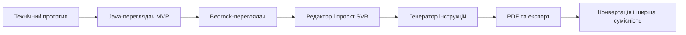

# ShemBuild — дорожня карта

> **Версія:** 1.0  
> **Статус:** погоджений напрям розвитку  
> **Основа:** [дизайн-документ](DESIGN.md), версія 2.1  
> **Планування:** етапами; календарні дати визначаються після прототипу й оцінки обсягу

## Мета

Розвивати ShemBuild від простого переглядача Minecraft-схем до редактора, який створює фізично виконувані покрокові інструкції та конвертує схеми між форматами, виданнями й версіями гри.

## Етапи

### 0. Технічний прототип

**Статус:** завершено 23 листопада 2026 року за результатом перевірки користувача.

**Мета:** перевірити, що запропонований Windows-стек підходить для інтерактивного перегляду блокових схем.

**Роботи:**

- Створити каркас C# / .NET 10 / WinUI 3.
- Підключити HelixToolkit.WinUI.SharpDX та відобразити блокову сцену.
- Відкрити тестові Java `.schem`, побудувати внутрішню модель блоків і керувати камерою.
- Перевірити відображення схем різного розміру й зафіксувати продуктивність, обсяг пам’яті та обмеження бібліотеки.

**Стан реалізації (2 листопада 2026 року):** створено каркас WinUI 3 / .NET 10, пробний читач Sponge `.schem` v2/v3 та 3D-переглядач на HelixToolkit. Застосунок зібрався й запустився після встановлення .NET 10 Desktop Runtime. C#-читач опрацював усі 11 прикладів у `schematic/`; усі мають GZip NBT Sponge v3, `DataVersion` 3700 і обсяг 312,832–16,121,388 позицій. Це перевірка на наявних файлах, а не заява про сумісність із Java 1.20.4.

У тесті застосунку `PantheonTemple` (63 × 47 × 136; 96,514 непорожніх блоків) відобразився в 3D. Читання та побудова сцени на фоні зайняли 116 мс, підготовка геометрії UI — 109 мс, алокація фонового етапу — близько 32,1 МБ; сцена мала 80,366 відкритих граней. Під час обертання viewport показав приблизно 144 FPS. Одноразовий C#-запуск читача на 11 файлах показав 20–401 мс та 3,5–111,7 МБ алокацій; наприклад, `Acropolis` на 16,121,388 позицій — 401 мс і 111,7 МБ.

Після візуального виявлення обрізаної сцени початкове кадрування та команда «Показати всю споруду» були перероблені: дистанція камери розраховується за проєкцією габаритів схеми, кутом огляду й співвідношенням сторін viewport, а дальня площина відсікання збільшується до глибини моделі. Користувач підтвердив, що текстури відображаються, `PantheonINSCRIPTION` видно повністю, а попередження спрацьовує для 1,423,600 граней. Статусний рядок зафіксував побудову сцени за 5,858 мс, підготовку UI-геометрії за 889 мс і близько 1,704.5 МБ алокацій. Поріг 750,000 граней є попередженням; рендер триває до аварійної межі 2,000,000 граней. Аварійну межу ще не перевірено на прикладі. Це не додає сумісності з будь-яким форматом або версією Minecraft до матриці.

Додано `ShemBuild.Rendering` для блокових станів, моделей і текстур та `ShemBuild.Resources` для ресурсних архівів і автоматичного завантаження офіційного клієнтського JAR у локальний кеш. У межах етапу 0 `DataVersion` 3700 був пов’язаний зі зразками Minecraft 1.20.4. Сумісність із версіями Minecraft не заявляється.

**Результат:** технічне рішення щодо 3D-бібліотеки й базової моделі даних. Якщо прототип не витримує потрібні розміри схем, оцінити альтернативний Direct3D renderer до початку повного MVP.

**Перехід далі, коли:** схема відкривається та відображається коректно, камера працює, а відомі обмеження продуктивності задокументовані.

### 1. MVP — Java Edition переглядач `.schem`

**Статус:** перший варіант реалізовано, зібрано й запущено; перевірка користувачем триває, етап не завершено.

**Мета:** дати користувачу змогу відкрити схему та оглянути її без редагування.

**Роботи:**

- Імпорт `.schem` для Java Edition.
- Визначення версії з метаданих, підтвердження версії або ручний вибір, якщо її не вказано.
- Інтерактивний 3D-перегляд: обертання ракурсу, масштабування камери, переміщення огляду та команда «показати всю споруду».
- Показ розмірів, початку координат, типів блоків і базової кількості матеріалів.
- Перевірка структури файлу, зрозумілі повідомлення для пошкоджених і непідтримуваних схем.
- Вихідний файл залишається незмінним.

**Реалізація першого варіанта:** додано вікно підтвердження/вибору стабільної версії перед рендером; `DataVersion` 3700 пропонує Minecraft 1.20.4, інші версії показують останній стабільний реліз як непідтверджену пропозицію. Автоматичні ресурси завантажуються для явно обраного релізу; невідомий `DataVersion` більше не спрямовується мовчки на останню версію. Додано панель розмірів, початку координат і Offset, список матеріалів із кількостями, клавіші Ctrl+O та F, а також повідомлення про формати, що поки не підтримуються. Англійська/українська мова інтерфейсу визначається мовою Windows.

Початкова ціль — найновіша стабільна версія Java Edition на момент початку етапу; snapshots і prereleases до MVP не входять. Станом на 23 листопада 2026 року офіційна сторінка Mojang вказує останній стабільний реліз [Java Edition 26.3](https://www.minecraft.net/en-us/article/minecraft-java-edition-26-3). Його підтримку ще не перевірено; актуальні дані див. у [матриці сумісності](COMPATIBILITY.md).

**Перехід далі, коли:** користувач підтвердить збірку та огляд на зразках; схема з початкової матриці відкривається, непідтримувані файли пояснені, матеріали й розміри видно, а джерело не змінюється. Сумісність із конкретною версією додається до матриці лише після перевірки на відповідному файлі.

### 2. Перегляд схем Bedrock Edition

**Мета:** додати підтримку другого видання без змішування його правил і блокових даних із Java Edition.

**Роботи:**

- Додати формати імпорту Bedrock, які визначить матриця сумісності.
- Зчитувати видання й версію та показувати їх користувачу.
- Відображати підтримувані Bedrock-схеми у тому самому 3D-переглядачі.
- Позначати невідомі блоки й властивості без мовчазного вилучення.

**Перехід далі, коли:** Java та Bedrock файли мають окремо задокументовані й перевірені комбінації форматів і версій.

### 3. Редактор схеми та самодостатній проєкт `.svb`

**Мета:** дати змогу змінювати будівлю та продовжувати роботу з проєктом на іншому комп’ютері.

**Роботи:**

- Додавати, видаляти й замінювати блоки.
- Обертати споруду кроком 90 градусів і переміщувати вибрані частини.
- Тримати масштаб камери окремо від геометрії блоків.
- Додати скасування та повторення дій.
- Ділити будівлю на частини окремими блоками, прямокутними виділеннями та названими вкладеними групами.
- Зберігати джерельну схему, правки, метадані й налаштування у самодостатній версійований файл `.svb`.

**Перехід далі, коли:** користувач може редагувати, зберегти й відкрити проєкт без втрати джерела та змін.

### 4. Генератор та редактор інструкцій

**Мета:** перетворювати схему на просту для повторення послідовність, яку можна виконати у Minecraft.

**Роботи:**

- Перед генерацією дозволити ручний поділ на частини або автоматичний поділ.
- У ручному режимі підтримати окремі блоки, прямокутні області й дерево логічних груп.
- В автоматичному режимі добирати найзрозумілішу послідовність, а не найкоротшу.
- Враховувати залежності розміщення блоків для вибраного видання та версії.
- Дозволити вибрати один або кілька типів тимчасових опор; додати кроки їхнього встановлення та прибирання.
- Показувати зміни на кожному кроці в 3D, рахувати матеріали для кроку й усієї будівлі окремо від опор.
- Дозволити змінювати назви, порядок і склад кроків.
- Якщо схема змінилася, запропонувати перебудувати інструкцію або залишити попередню з позначкою застарілої. Сумісні ручні правки переносити; для конфліктних кроків дати вибрати старий ручний чи новий згенерований варіант.

**Перехід далі, коли:** інструкція враховує відомі залежності розміщення, а кроки з неперевіреними умовами явно позначені.

### 5. Формат проєкту та експорт

**Мета:** зберігати редаговану роботу й поширювати готові інструкції.

**Роботи:**

- Розвинути `.svb` як самодостатній контейнер вихідної схеми, правок, груп, інструкції та її версії.
- Додати експорт зміненої або конвертованої схеми у вибраний підтримуваний формат.
- Експортувати інструкцію в PDF із вибором розміру сторінки, орієнтації та мови.
- Оформити PDF як LEGO-подібний посібник: оглядова сторінка з усією спорудою й матеріалами, далі окрема сторінка на крок із зображенням, нумерацією, стрілками та переліком потрібних блоків.
- Відображати тимчасові опори окремо від матеріалів будівлі.

**Перехід далі, коли:** `.svb` можна перенести й відкрити на іншому комп’ютері, а PDF відповідає вибраним параметрам і зберігає послідовність кроків.

### 6. Конвертація та розширення сумісності

**Мета:** поступово охопити формати й версії Java Edition та Bedrock Edition.

**Роботи:**

- Додавати адаптери імпорту й експорту окремими форматами та версіями.
- Конвертувати у вибрану користувачем цільову версію/видання та формат, зберігаючи оригінал окремо.
- Зіставляти блоки за зовнішнім виглядом і функцією.
- Показувати приблизні заміни й вимагати підтвердження для кожного блока окремо.
- Якщо немає прийнятного відповідника або властивість не переноситься, призупиняти конвертацію й просити ручну заміну.
- Поповнювати матрицю лише комбінаціями, які перевірені на представницьких файлах.

**Перехід далі, коли:** результат конвертації створюється в окремій копії, неперенесені блоки не зникають мовчки, а всі обмеження вказані користувачу.

## Робота, що проходить через усі етапи

- Українська й англійська локалізації; початкова мова з налаштувань Windows.
- Світла й темна тема відповідно до теми Windows.
- Клавіатурне керування основними діями, повідомлення без опори лише на колір.
- Некоректні та великі файли обробляються без втрати вихідних даних і без блокування інтерфейсу.
- Матриця сумісності містить версію формату, видання/версію Minecraft і відомі обмеження.

## Поза дорожньою картою

- Автоматично будувати споруди у світі Minecraft.
- Керувати сервером, інвентарем чи персонажем.
- Спільно редагувати проєкт або підтримувати каталог схем із профілями й рейтингами.
